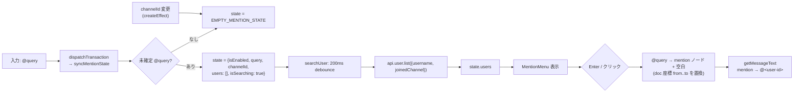

# GiracleTextinput — メンション入力

ProseMirror ベースのテキスト入力。`@` でユーザー候補を出し、選択するとメンションとして確定する。
エディタ上の表示は `@ユーザー名`、送信時は `@<user-id>` にシリアライズする。

プロジェクト仕様として装飾は「メンション」と「URL の下線」だけ。スキーマに `marks` を定義して
いないため、太字・斜体などのリッチ書式は構造的に流入できない。

依存は `prosemirror-model` / `prosemirror-state` / `prosemirror-view` /
`prosemirror-history` / `prosemirror-commands` / `prosemirror-keymap`。
`baseKeymap` だけを keymap に載せる（段落結合・Ctrl+A 等の編集キー）。
schema-basic は使わない（スキーマは自前定義）。

## ProseMirror の基本（このコードを読むための前提）

### 1. スキーマとドキュメント

- 文書構造は `Schema` で定義する（`pmSchema.ts`）。ここでは `doc → block+`、`paragraph → inline*`、
  `inline` グループに `text` と `mention` だけ。
- `mention` は `atom: true`（内部を持たない 1 単位のインラインノード）。`selectable: false` なので
  クリック・矢印でノード選択にならず、キャレットは前後どちらかに落ちる。DOM 上は
  `contenteditable="false"` の span になり、**Backspace 1 回でノードごと消える**（メンション直後の
  半角空白にカーソルがある場合だけ `handleKeyDown` が自前で消す）。
- 各ノード型は `toDOM`（DOM 生成）と `parseDOM`（HTML からの取り込み、ペースト・ドロップ経路）を持つ。
  `mention` の `parseDOM` は `span[data-mention-user-id]` を受け、`userId` を `/^[a-f0-9-]{1,64}$/`
  で検証し、`name` から制御文字を除去して 128 文字に切り詰める（受信側 `mentionPattern` と同じ文字種）。

### 2. State / Transaction / dispatch

- `EditorState` は不変のスナップショット（doc + selection + plugin state）。
- 変更は `state.tr`（Transaction）に積み、`view.dispatch(tr)` で適用する。
- `index.tsx` は `dispatchTransaction` を自前実装しており、`tr` にメンション後スペーサーを
  足してから `view.state.apply` → `view.updateState` する。**状態の反映点はここ 1 箇所**。
  適用後に `getMentionQuery` を読んでメニュー状態を更新する（再帰的に transaction を投げない）。
- 座標は「ノード境界＝1 位置」で数える。text ノードは 1 文字 1 位置、`mention` も 1 位置。

### 3. Plugin

- `urlUnderlinePlugin`（`pmUrlUnderline.ts`）は plugin state に `DecorationSet` を持ち、
  `tr.docChanged` のときだけ段落単位で `Decoration.inline(..., { class: "underline" })` を張り直す。
  デコレーションは表示専用で doc を書き換えないため、送信文字列に影響しない。
- IME 変換中でも transaction は飛ぶが、`prosemirror-view` は構成中のノードの DOM を保持するため
  デコレーション再計算で変換が壊れない。

### 4. contentDOM とキー入力

- `EditorView` はマウント先の div の中に `contenteditable` な contentDOM を作る。
  `attributes` で `id="messageInput"` と class を付けており、**id はこの contentDOM が持つ**。
- キー処理は `handleKeyDown` 1 個に集約している（keymap プラグインは使わない）。先頭で
  `view.composing` を検査し、IME 変換中は一切横取りしない。これがスマホ Firefox での
  変換中断を避けるための要。

## データの流れ



状態は `IMentionState`（`isEnabled` / `query` / `users` / `selectIndex` / `channelId` / `isSearching`）
1 つだけ。`index.tsx` が signal を持ち、`dispatchTransaction` が更新する。`channelId` は検索時点の
チャンネル（切替検出用）で、`createEffect` が切替時に即 `EMPTY_MENTION_STATE` へ戻す。

## ファイルごとの役割

### `pmSchema.ts`

- `pmSchema` — `doc` / `paragraph` / `text` / `mention` のみ。`marks` 無し。
- `createEmptyDoc()` — 空段落 1 個の doc（初期状態・送信後クリア・`clear()` で使用）。
- `getMessageText(doc)` — トップレベルのブロックを `\n` で結合。`mention` は `@<user-id>`、
  素テキスト中の `@<` は `@\u200B<`（ゼロ幅スペース）にエスケープし、受信側で偽メンションとして
  描画されるのを防ぐ。
- `getMentionQuery(state)` — カーソル直前の未確定 `@query` を `{ query, from, to }`（doc 座標）で返す。
  - 選択が collapsed な text cursor のときだけ。
  - 段落内のカーソル前テキストを `textBetween` で取り、`mention` は 1 文字分の空白として扱う。
    これにより `@` の後ろにチップが挟まる場合は検出されない。
  - 確定済み `@<` と、`@` 直前が ASCII 英数字/`_` のケース（`foo@bar`）は除外。CJK は対象外なので
    `こんにちは@田中` は検出される。
- `withMentionSpacer(tr)` — メンション直後のテキストが空白以外で始まる場合、その先頭に半角空白を
  1 個挿入する。受信側は `@<user-id>` の直後を `\b` 依存でリンク化するため、`@bobhttps://…` の
  ままだと下線範囲と送信後の描画が食い違うのを防ぐ。挿入は座標のずれを避けて後ろから行う。
- `URL_PATTERN_SOURCE` / `findUrlRanges(text)` — `MessageTextRender.tsx` の `urlPattern` と同一ソース。
  `g` フラグは共有せず、必要なたび `RegExp` を作る（`lastIndex` 残留を避ける）。

### `pmUrlUnderline.ts`

URL 範囲に `underline` クラス（Tailwind の `underline`）を付ける Plugin。
段落全文（`mention` は 1 文字の代替文字）から範囲を求め、`pos + 1 + offset` で doc 座標に変換する。
受信側と同じ URL パターンなので、エディタの下線範囲と送信後のリンク範囲が一致する。

### `MentionMenu.tsx`

表示専用コンポーネント。`items` / `selectIndex` / `onSelect` を受け取るだけ。
`onMouseDown` で `preventDefault` し、クリック時にエディタからフォーカスが外れないようにしている。

### `index.tsx`

- `EditorView` の生成・破棄。plugin は `history()`（Undo/Redo）、`keymap(baseKeymap)`（段落結合・Ctrl+A 等の標準キー）、`urlUnderlinePlugin()`。
  `handleKeyDown`（コンポーネント直下の prop）は plugin より先に評価されるため、composition ガードが常に最優先。
- `mentionState` signal と `menuItems`（`createMemo`、アイコン URL は `encodeURIComponent`）。
- `searchUser(query, channelId)` — 200ms debounce、切替後の `channelId` 不一致は破棄、応答も
  クエリ・チャンネル一致時のみ反映、失敗時は `isSearching` を戻す。3 秒 watchdog が
  「応答が来ない間 Enter が握りつぶされる」状態を解除する。
- `handleKeyDown` の分岐（上から順）:
  1. `view.composing` なら `false`（IME 変換中のキーは一切触らない）。
  2. `Enter` — メニュー有効なら候補確定。候補 0 件でも `isSearching` の間は `Enter` を消費して
     誤送信を防ぐ（`isSearching` が false なら通常送信へ流す）。未消費の `Enter` は送信: Shift+Enter は `tr.split` で改行、`sendWithCtrlKey()` が
     true なら Ctrl 必須、本文が空白のみで `canSendEmpty()` が false なら何もしない。送信後は
     無条件に本文をクリアする（`ChannelTextInput` の `sendMsg` と同じ）。
  3. `ArrowUp` / `ArrowDown` — メニュー有効かつ候補ありのときだけ選択移動。それ以外は `false` を
     返し、親（`ChannelContents`）の ArrowUp 編集ショートカットへ流す。
  4. `Escape` — メニューを閉じる。
  5. `Ctrl/Cmd+Z` / `Ctrl/Cmd+Shift+Z` / `Ctrl/Cmd+Y` — `prosemirror-history` の `undo` / `redo`。
     Ctrl+B/I/U 等はハンドラ不要（marks が無いので書式は付かない）。
- `handleDOMEvents.paste` — 既定動作は使わず `preventDefault` して plain text だけを挿入する
  （PM 既定は `text/html` を優先し、`<br>` を段落内の改行文字・`<li>` を区切りの無い連結にするため、
  表示と送信文字列が食い違う）。クリップボードにファイルがあれば `onPasteFiles` へ渡す。
  ドロップは既定処理（挿入位置はドロップ座標）。
- `ref(handle)` — `getText()` は `getMessageText(view.state.doc)`、`clear()` は doc を空段落へ置換、
  `focus()` は `view.focus()`。
- `onCleanup` で debounce/watchdog タイマーを止め、`view.destroy()` する。

## 使い方

```tsx
import GiracleTextinput from "~/components/unique/GiracleTextinput/index.tsx";

<GiracleTextinput channelId={channelId()} onEnter={(text) => api.message.send({ channelId: channelId(), message: text, fileIds: [] })} />
```

- `channelId` を渡すと `api.user.list` の `joinedChannel` に載り、そのチャンネル参加者に絞られる。省略時は全ユーザー検索。
- `onEnter` に渡るのは `getMessageText(doc)` の戻り値（`@名前` → `@<user-id>` 変換済みの送信文字列）。コールバック後、コンポーネントが本文をクリアする（エディタは外に出さない）。
- `onPasteFiles(files)`: クリップボードにファイルがある場合に呼ばれる（テキスト挿入は通常どおり継続）。
- `sendWithCtrlKey()`: true を返す間は Ctrl+Enter でのみ送信する。
- `canSendEmpty()`: true を返す間は本文が空でも Enter を `onEnter("")` へ流す（添付のみ送信用）。
- `ref(handle)`: `{ getText(), clear(), focus() }` を受け取る。送信ボタン等から本文取得・クリア・フォーカスに使う。

## 落とし穴

- 受信側の `mentionPattern`（`/@<([a-f0-9-]+)>/g`）は `[a-f0-9-]` のみ受け付ける。`u1` のような ID を挿入しても、送信後の本文はメンションとして描画されず素テキストになる。
- 段落結合は `\n`（単一）。送信経路が素の textarea（`ChannelTextInput.tsx`）と同じ形式で、受信側は `whitespace-pre-wrap` 描画のため。
- ZWSP エスケープは本文・保存・通知文にそのまま残る。不可視で表示に影響はない。もしサーバ側が本文の `@<id>` を通知トリガーにしているなら、エスケープ済みテキストはトリガーにならない（偽装防止として意図通り）。
- メンションは atom なので内部にキャレットが入らない。Backspace はブラウザ既定の contentEditable 編集でノードごと消え、その DOM 変更を ProseMirror が取り込む。
- メンション確定時に直後へ入れる空白は **NBSP**。通常の空白だと段落末で Chrome が折り畳み、次の 1 文字入力でその空白が置換される（メンションと本文がくっつく）。送信時に `serializeInline` が通常の空白へ戻す。
- Chrome はメンション隣の空白も NBSP に置換する。doc 内の NBSP を transaction で書き換える補正は入れない（書き換え後の次の入力がその 1 文字を置換してしまい逆効果だった）。送信時に正規化する。
- メンション直後に空白なしで文字が続く場合（NBSP を消してから入力した場合など）、送信文字列では `serializeInline` が半角空白を 1 個補う。受信側 `urlPattern` の `\b` 境界（`@<user-id>https://…` をリンク化させる）のため。
- メンション検索の API が応答しない(ハング)場合、Enter は最大 3 秒握りつぶされる。watchdog（`searchUser` 内）が `isSearching` を戻せば通常動作に復帰する。
- コピー時のテキスト化は `clipboardTextSerializer` を明示している。PM 既定の `Fragment.textBetween` は atom を空文字にするため、指定しないとコピーしたチップがテキストから消える（HTML 側には残る）。
- ペーストは基本的に plain text 固定（`<br>`・`<li>` の取りこぼし回避）。ただし HTML に `data-mention-user-id` を含む場合（＝自前のコピー）だけは PM にパースさせ、`parseDOM` でチップへ戻す。
- contentDOM は `id="messageInput"` を保つこと。`ChannelContents`（↑ キーで編集モード、入力有無は `textContent` で判定）と `EditMessage`（編集の保存・キャンセル後のフォーカス復帰）が `document.getElementById("messageInput")` で参照している。`<textarea>` 前提の `.value` 判定は div では常に `undefined` になりガードが効かない。
- 送信・確定・メニュー操作のキー処理は keymap に載せず `handleKeyDown` 1 個に集約すること。`handleKeyDown` は plugin より先に評価され、先頭の composition ガードが IME 変換中の誤送信・誤挿入を防いでいる。`keymap(baseKeymap)` は編集系キー専用。
- スキーマに `marks` を足すと、ペースト経路や Ctrl+B で書式が流入する。装飾を増やす場合も `Decoration`（表示のみ）で行うこと。
