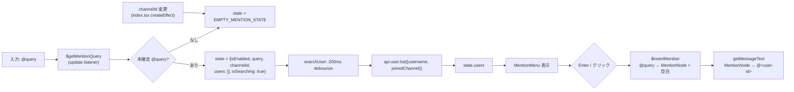

# GiracleTextinput — メンション入力

Lexical ベースのテキスト入力。`@` でユーザー候補を出し、選択するとメンションとして確定する。
エディタ上の表示は `@ユーザー名`、送信時は `@<user-id>` にシリアライズする。

プロジェクト仕様として装飾は「メンション」と「URL の下線」だけ。太字・斜体などのリッチ書式は
`PlainTextOnlyExtension` で無効化している（`RichTextExtension` はタイピング・改行のためだけに残す）。

## Lexical の基本（このコードを読むための前提）

React のような「状態 → 再レンダリング」モデルではなく、**イミュータブルなドキュメントツリーを update で書き換える**モデル。

### 1. EditorState と update / read

- エディタの中身は `EditorState`（ノードツリー＋選択）。commit 済みの状態は凍結されたスナップショットで、直接書き換えない。
- 書き換えは `editor.update(() => { ... })`。コールバックは同期的に実行されるが、変更は**保留中のコピー**に積まれ、同じ tick の複数 update がまとめて commit・DOM 反映される。リスナー（`registerUpdateListener`）はその反映後に呼ばれる。
- 読み取りは `editorState.read(() => { ... })`（特定スナップショット）、`editor.getEditorState().read(...)`（最新の commit 済み状態）、`editor.read('latest', ...)`。
- **`$` で始まる関数は update / read のコールバック内でしか呼べない**（`$getSelection`、`$createTextNode` など）。コマンドハンドラとノード transform は最初から update の中で動くので、そこでも呼べる。このリポジトリの `$getMentionQuery` / `$insertMention` / `$serializeNode` も同じ規約で、呼べる文脈を名前で表している。外から呼ぶと Lexical がエラーにする。

### 2. ノードツリー（DOM ではない）

- 構造は `RootNode → ParagraphNode（ElementNode）→ TextNode / MentionNode`。`MentionNode` は `TextNode` のサブクラスなので、テキストと同じ場所に並ぶ。
- DOM はツリーから生成される副産物。ノード側のフックが DOM との橋渡しをする。
  - `createDOM` — エディタ表示用の要素を作る。`TextNode` は書式なしなら span、bold/italic 付きなら strong/em を返し、`MentionNode` はそれに `mention-node` クラスを足す（書式自体は `PlainTextOnlyExtension` により発生しない）。
  - `exportDOM` — コピー・HTML 出力用の要素。既定実装は `createDOM` と同じ要素を返し、`MentionNode` が `data-mention-user-id` / `data-mention-name` を付ける。
  - `importDOM` — HTML からノードを作る変換（`$generateNodesFromDOM` 系。後述の注意参照）。
  - `exportJSON` / `importJSON` — 履歴・コピー・復元用のシリアライズ。
- ノードの書き換えは `node.getWritable()`（コピーオンライト）。`setMode` などのセッターは内部でこれを呼ぶ。`clone` はノード複製時に呼ばれ、`__userId` のような独自フィールドを引き継ぐ役割を持つ。

### 3. token モード

`TextNode` は既定（`normal`）だと文字単位で編集できる。`setMode("token")` にすると**内容を書き換えられない不変ノード**になり、削除もノードごとまとめて行われる。本実装はこれで `@Alice` の文字を直接編集して壊すことを防いでいる。

なお token だけでは**矢印キーでノード内部のオフセットにキャレットが入る**（実測: `@Alice` の offset 1〜5 に入れた）。これを防ぐのが後述の `SELECTION_CHANGE` ハンドラ。

### 4. コマンド（キー入力の横取り）

- キー操作や選択変更は「コマンド」として発行され、`editor.registerCommand(COMMAND, handler, priority)` で処理を差し込める。
- handler が `true` を返すと「処理済み」となり、既定動作は走らない。`false` を返すと Lexical の既定処理に任せる。
- 本実装の `KEY_ENTER`（候補確定）、`KEY_BACKSPACE`（メンション丸ごと削除）、`KEY_ESCAPE`（メニュー閉じる）、`SELECTION_CHANGE`（カーソルのスナップ）がこれ。
- コマンドハンドラは常に update の中で呼ばれる。公式ドキュメントは**コマンドリスナ内で同期的に `editor.update` を呼ぶことを禁止**している（入れ子の update は即時実行されず、外側の commit に合流する形で後回しになり、選択や DOM のタイミングがずれる）。`KEY_ENTER` が `setTimeout` で挿入を後ろへ回しているのはこのため。

### 5. Extension と register

- 機能は `defineExtension({ name, nodes, dependencies, $initialEditorState, register })` の単位で定義し、`buildEditorFromExtensions(...)` で合成する（`index.tsx`）。
- `nodes: [MentionNode]` でノード型を登録、`dependencies` で前提拡張（`RichTextExtension` 等）を宣言する。
- `$initialEditorState` はエディタ生成時に一度だけ走る初期化。ここでは空の `ParagraphNode` を1つ置いている。
- `register(editor)` はエディタ構築時に呼ばれ、**解除用の破棄関数を返す**。エディタ破棄時に Lexical がそれを呼ぶ。複数の登録は `mergeRegister(...)` で1つにまとめている。
- `editor.registerUpdateListener(...)` は「状態が変わったとき」のフック。ここで `editorState.read` して `@query` を検出している。

### 6. 選択（Selection）

- `$getSelection()` は `RangeSelection`（`anchor` / `focus` の2点と各 `offset`）、`NodeSelection`、`null` のいずれか。`isCollapsed()` はキャレット（幅ゼロ）かどうか。
- `anchor` は選択を始めた点、`focus` は終了点。単一キャレットなら両者は一致する。
- `SELECTION_CHANGE_COMMAND` は commit 前の書き込み可能な update 内で発火する（`$getSelection()` は保留中の選択、`$getPreviousSelection()` は直前の commit 済み選択）。リスナが選択を変えると再度通知が来るため、収束する必要がある。本実装は端（offset 0 / size）へ寄せるだけで、端の選択は次回スキップするのでループしない。
- IME 変換中は `editor.isComposing()` が `true`。変換中の選択変更に干渉すると日本語入力が壊れるため、スナップ処理はここで早期 return する。

## データの流れ



状態は `MentionState`（`isEnabled` / `query` / `users` / `selectIndex` / `channelId` / `isSearching`）1つだけ。`index.tsx` が signal を持ち、extension は setter 経由で更新する。`channelId` は検索時点のチャンネル（切替検出用）で、`index.tsx` の `createEffect` が切替時に即 `EMPTY_MENTION_STATE` へ戻す。

## ファイルごとの役割

### `MentionNode.ts`

`TextNode` を継承したメンションノード。

- ノードのテキスト（= エディタ表示）は `@ユーザー名`、`__userId` / `__name` を別に保持する。
- `setMode("token")` により `@名前` は内容を書き換えられない不変ノードになり、削除はノードごとまとめて行われる。
- `exportDOM` は `data-mention-user-id` / `data-mention-name` を付けた span を出力、`exportJSON` / `importJSON` でコピー・履歴復元に耐える。
- `importDOM` は HTML から span を取り込む際（`$generateNodesFromDOM` 系）の検証:
  - `userId` は `/^[a-f0-9-]{1,64}$/`（受信側 `MessageTextRender` の `mentionPattern` と同じ文字種）。不正なら `null` を返し、priority 0 の `TextNode` の span 変換にフォールバックして素テキストになる。
  - `name` は制御文字を除去し 128 文字に切り詰める。

**注意**: Lexical 0.53 のペーストは `@lexical/clipboard` の extension ベース DOM インポートを通り、`Node.importDOM` を参照しない。したがって現状ペーストしたメンション span は素テキストになり、この検証は将来経路・他経路向けの防御として効く。

### `MentionExtension.ts`

エディタ拡張本体。`defineMentionExtension(options, state)` で組み立てる。

- `$getMentionQuery()` — カーソル直前の未確定 `@query` を返す。確定済み `@<id>` と、`@` 直前が ASCII 英数字/`_` のケース（`foo@bar`）は除外。CJK は対象外なので `こんにちは@田中` は検出される。
- `$insertMention(editor, user)` — `@query` 部分だけを `MentionNode` に置換し、直後に空白ノードを挿入してカーソルをその後ろへ移す。
- `$serializeNode` / `getMessageText(editor)` — ルート直下のブロックを `\n` で結合しつつ、メンションノードを `@<user-id>` に変換（ブロック内の子は連結）。素テキスト中の `@<` は `@\u200B<`（ゼロ幅スペース）にエスケープし、受信側で偽メンションとして描画されるのを防ぐ。
- 登録コマンド:
  - update listener — `@query` 検出、メニュー状態更新、検索発火。同じクエリでも `channelId` が変われば `users` を捨てて再検索する。`searchUser(query, channelId)` は debounce タイマ発火時に現在の `channelId` と照合し、切り替わっていれば古い検索を破棄する。応答もクエリ一致時のみ反映し、失敗時は `isSearching` を戻す。
  - `SELECTION_CHANGE` — メンション内部にカーソルが入ったら前後の端へスナップ。IME 変換中は何もしない。
  - `KEY_ENTER` / `KEY_ARROW_UP` / `KEY_ARROW_DOWN` — 候補の確定・移動。候補0件でも `isSearching` の間（debounce 未完了）は Enter を消費し、メンション未確定の本文が誤送信されないようにする。`@zzz` のように 0 件で確定した後は `isSearching === false` なので従来どおり本文として送信される。
  - `KEY_BACKSPACE` — メンション境界の Backspace でノードごと削除。
  - `KEY_ESCAPE` — メニューを閉じる。
- ノード transform（`TextNode`）— 直前がメンションで、テキストが空白以外で始まる場合は先頭にスペースを挿入する。受信側は `@<user-id>` の直後を `\b` 依存でリンク化するため、表示が `@bobhttps://…` のままだとエディタの下線（表示文字列基準）と送信後の描画が食い違うのを防ぐ。IME 変換中はスキップ。

### `UrlUnderlineExtension.ts`

URL 部分(TextNode)に underline 書式を付け、theme の `text.underline` クラス(Tailwind の `underline`)で下線表示する。検出は `MessageTextRender` と同じ URL パターンで、受信側のリンク描画範囲と一致する。書式なので `getMessageText` の送信文字列には影響しない。

- 走査は `TextNode` の node transform。キー入力と同一 update 内で適用されるため、update listener + 後追い update(と `history-merge` タグ)による履歴断片化が起きない。適用範囲は親ブロックのみで、ルート全体は走査しない。
- `ParagraphNode` の transform は段落自身が dirty にならない限り発火しない(既存テキストへの追記は text ノードだけを dirty にする)ため使えない。
- IME 変換中はスキップし、確定時の update で適用される。
- 既知の制限: URL を編集している間の Undo は1文字単位のまま。分割・書式適用で dirty ノードが2つ以上になった update を `@lexical/history` がマージ不可(OTHER)と判定するため。
- 改行(`LineBreakNode`)は透過扱い。オフセット計算(`\n` 相当)にだけ使い、分割・書式変更の対象にはしない。Shift+Enter を含む段落でも下線が止まらない。
- メンション(`MentionNode`)は分割・書式変更の対象外。

### `PlainTextOnlyExtension.ts`

リッチ書式の流入を塞ぐ拡張。`@lexical/rich-text` はタイピング・Enter・改行コマンドのために残しつつ、
書式が発生する経路だけを HIGH 優先度で先取りする。

- `PASTE_COMMAND` — `preventDefault` して `text/plain`（無ければ `text/uri-list` → `text/html` の `textContent`）だけを `insertRawText` で挿入。`@lexical/rich-text` の HTML ペースト（`$insertDataTransferForRichText`）は走らない。
- `DROP_COMMAND` — 同じ処理を自前で行う。`$handlePlainTextDrop` は Lexical 外からのドラッグ（ドラッグ元マーカーなし）で `false` を返し、そのままブラウザ既定の `insertFromDrop` に流れると `CONTROLLED_TEXT_INSERTION_COMMAND` 経由でリッチ書式が取り込まれてしまうため使わない。
- `FORMAT_TEXT_COMMAND` / `SET_TEXT_FORMAT_COMMAND` — `true` を返して消費。コアの Ctrl+B/I/U/S 等で書式が付かない。

副作用: plain text 経路では1回の入力が単一 TextNode になるため、`$getMentionQuery` の「アンカーノード単体しか見ない」制約が実害にならない（書式付きノードが再流入する経路を足すと再発する）。

### `MentionMenu.tsx`

表示専用コンポーネント。`items` / `selectIndex` / `onSelect` を受け取るだけ。
`onMouseDown` で `preventDefault` し、クリック時にエディタからフォーカスが外れないようにしている。

### `index.tsx`

- `editor` の生成・破棄（`buildEditorFromExtensions` + `definePlainTextOnlyExtension` + `HistoryExtension` + `HMRExtension`）。plain text 拡張は他より先に登録するが、優先度 HIGH で書式経路を先取りするため順序自体は結果に影響しない。
- `mentionState` signal と `menuItems`（`createMemo`、アイコン URL は `encodeURIComponent`）。
- `channelId` は `() => props.channelId` の getter として渡すため、チャンネル切り替え後の検索でも最新値を参照する。加えて `createEffect` が `props.channelId` の変化を監視し、切替時は `mentionState` を即 `EMPTY_MENTION_STATE` に戻して古い候補を閉じる（再検索は次の update listener 発火時）。
- `onEnter?: (text: string) => void` — Enter で `getMessageText` の送信文字列を親へ渡す。`KEY_ENTER_COMMAND` を `COMMAND_PRIORITY_NORMAL` で登録するため、メンション確定（HIGH）が優先され、未消費の Enter だけが届く。Shift+Enter は改行のまま、IME 変換中の Enter は送信しない。未指定時は従来通り改行になる。送信後はエディタを無条件クリアする(`ChannelTextInput` の `sendMsg` と同じ挙動)。空行(空白のみ含む)の Enter は送信も改行もしない。

## 使い方

```tsx
import GiracleTextinput from "~/components/unique/GiracleTextinput/index.tsx";

<GiracleTextinput channelId={channelId()} onEnter={(text) => api.message.send({ channelId: channelId(), message: text, fileIds: [] })} />
```

- `channelId` を渡すと `api.user.list` の `joinedChannel` に載り、そのチャンネル参加者に絞られる。省略時は全ユーザー検索。
- `onEnter` に渡るのは `getMessageText(editor)` の戻り値（`@名前` → `@<user-id>` 変換済みの送信文字列）。コールバック後、コンポーネントがエディタをクリアする（editor は外に出さない）。

## 落とし穴

- 受信側の `mentionPattern`（`/@<([a-f0-9-]+)>/g`）は `[a-f0-9-]` のみ受け付ける。`u1` のような ID を挿入しても、送信後の本文はメンションとして描画されず素テキストになる。
- 段落結合は `\n`（単一）。送信経路が素の textarea（`ChannelTextInput.tsx`）と同じ形式で、受信側は `whitespace-pre-wrap` 描画のため。
- ZWSP エスケープは本文・保存・通知文にそのまま残る。不可視で表示に影響はない。もしサーバ側が本文の `@<id>` を通知トリガーにしているなら、エスケープ済みテキストはトリガーにならない（偽装防止として意図通り）。
- `@<` のエスケープはノード単位。Lexical がテキストノードを `@` と `<` の境界で分割した場合は取りこぼしうるが、通常入力では結合されるため実害はない。
- 外部アプリからのドロップは `DROP_COMMAND` で自前処理するため、**挿入位置は現在のキャレットでドロップ座標ではない**（`shortcut:` コメントあり）。位置合わせが必要になったらドロップ座標からのキャレット解決を実装する。
- メンション直後のスペーサーは transform で強制されるため、Delete で消しても次に文字を打った時点で空白が戻る。これは受信側 `urlPattern` の `\b` 依存（`@<user-id>https://…` をリンク化させる）に合わせるための仕様。スペースを保持するノードと URL ノードは書式が違うため1ノードには統合されない。
- メンション検索の API が応答しない(ハング)場合、Enter は最大 3 秒握りつぶされる。watchdog(`searchUser` 内 `watchdogTimer`)が `isSearching` を戻せば通常動作に復帰する。
- `RichTextExtension` を外すとタイピング・Enter・改行コマンドが壊れる。無効化は `PlainTextOnlyExtension` の経路遮断だけで行うこと（片方だけ塞ぐと書式が流入する）。
